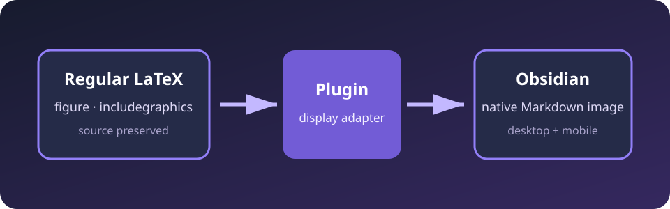

# 综合测试 \label{sec:test-root}

请把本文件、`references.bib` 和 `latex-references-test-figure.svg` 放在 vault 的同一目录。
源码模式必须始终保留本文中的正规 LaTeX；Live Preview 和阅读视图只做临时显示转换。

## 普通 Markdown 不受影响 \label{sec:markdown}

- [原生页内链接](#原生-markdown-目标)
- **粗体**、*斜体*、任务列表和 `行内代码`
- 普通 Markdown 图片：

### 原生 Markdown 目标

上面的链接应继续由 Obsidian 处理。

## 公式 \label{sec:equations}

$$
\begin{equation}
E=mc^2
\label{eq:energy}
\end{equation}
$$

公式~\ref{eq:energy}与公式~\eqref{eq:energy}都应显示 `(1)`。

下面的普通公式没有引用命令，必须保持 Obsidian 原有行为：

$$
a^2+b^2=c^2
$$

## 正规 LaTeX Figure \label{sec:figure}

\begin{figure}[!htbp]
  \centering
  \includegraphics[
    width=0.75\linewidth,
    keepaspectratio
  ]{latex-references-test-figure}
  \caption[测试图]{LaTeX References 的\textbf{原生 Markdown 显示}测试}
  \label{fig:workflow}
\end{figure}

图~\ref{fig:workflow}应显示为可点击的“图 1”。点击后应滚动到渲染后的图片，
不应把光标移动到 `\label{fig:workflow}`。

## 外部 BibTeX 文献 \label{sec:citations}

单篇引用~\cite{knuth1984}，多篇引用~\cite{lamport1994,knuth1984}，
带定位信息的引用~\cite[见][p. 97]{knuth1984}。

所有条目必须来自同目录的 `references.bib`。Markdown 代码块不再作为文献数据源。

## 忽略区域

下面的内容必须保持普通代码，不能建立标签、figure 或文献条目：

```latex
\begin{figure}
\includegraphics{ignored.png}
\label{fig:ignored}
\end{figure}
\cite{ignored-citation}
```

## 最终检查

- 没有引用命令的 Markdown 和数学内容不发生变化。
- 正规 LaTeX figure 源码没有被写回或改写。
- figure 图片由 Obsidian 原生 Markdown 渲染器显示。
- 公式、标题、figure 和 `.bib` 文献引用都可以跳转。
